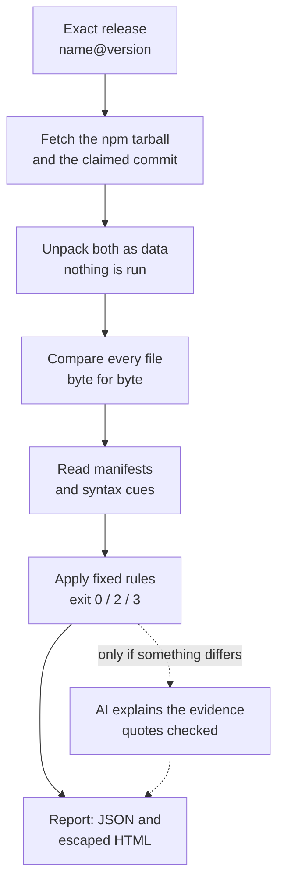
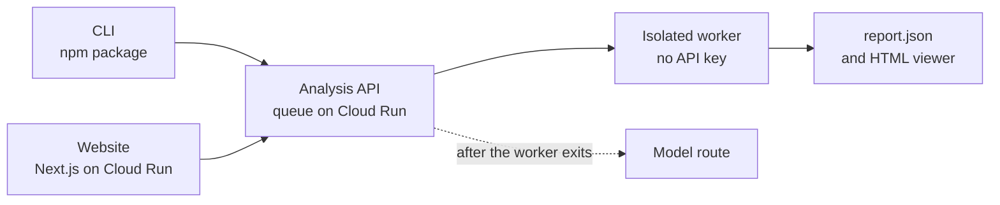

<div align="center">

# UNMASK

### See what actually shipped.

**The code you review on GitHub is not the code you install from npm.**<br>
UNMASK compares the two, byte for byte, and shows the evidence for every difference.

[](https://www.npmjs.com/package/@xagents_in/unmask)
[](LICENSE)
[](.nvmrc)
[](HACKATHON.md)

[**Try the website**](https://unmask-web-386156642190.asia-south1.run.app) ·
[Analysis API](https://unmask-386156642190.asia-south1.run.app/version) ·
[npm package](https://www.npmjs.com/package/@xagents_in/unmask) ·
[Engineering docs](docs/README.md)

</div>

---

## The problem in 30 seconds

Developers review source code. Machines install the **published tarball**. Nothing
forces the two to match: npm checks the tarball's hash, never its source.

Attackers know this. Some of the worst supply-chain attacks hid their payload
**only in the published package**:

| Year | Package                 | What shipped that was never committed      |
| ---- | ----------------------- | ------------------------------------------ |
| 2018 | `flatmap-stream 0.1.1`  | A payload only in the minified npm file    |
| 2018 | `eslint-scope 3.7.2`    | A `postinstall` that stole `.npmrc` tokens |
| 2024 | `xz-utils 5.6.0`        | A backdoor only in the release tarballs    |
| 2025 | `@ctrl/tinycolor 4.1.1` | A `bundle.js` added by the Shai-Hulud worm |

Existing tools answer other questions. Vulnerability databases ask _"is this
version known bad?"_. Behaviour scanners ask _"does it look malicious?"_. npm
provenance asks _"where was it built?"_. **UNMASK asks: "what shipped that is not in
the source, and where exactly?"**

## Try it in one minute

**On the web:** open the [website](https://unmask-web-386156642190.asia-south1.run.app),
type an exact release such as `chalk@6.0.1`, and press **check it**.

**From a terminal:**

```bash
npx @xagents_in/unmask check chalk@6.0.1
```

The terminal shows the result, coverage, findings, known advisories, the AI
explanation status and next steps. Add `--out ./unmask-report` to also save
`report.json` and an escaped `report.html`; nothing is written without it. Only the
package name and version leave your machine; the hosted service does the rest.

### What the terminal shows

The examples below are real CLI output from a local test server with synthetic
fixtures and recorded OSV advisory data. They are not live-service results.

A completed check prints the result and exit code, coverage, findings, the OSV
advisories for that exact version, the AI status and next steps. The AI summary
appears only when the model actually returned one; otherwise the line names the
status, such as `unavailable (quota)`, and nothing stands in for it.

```text
UNMASK fixture@1.0.0
Result    Deterministic findings need review (exit 3)
Coverage  complete: 1 file, 81 B
          0 byte-identical, 1 changed, 0 artifact-only, 0 not-compared
Source    selected via user-full-SHA at dddddddddddd
Findings  1
  - lifecycle-source-absent (script install)
Advisory  none reported by OSV for this exact version
AI        complete, 0 hypotheses (separate from deterministic evidence)
  Summary: The artifact declares an install script that the selected source does not.
  Scope: 1 evidence items supplied, 0 omitted; not checked: runtime-behavior
  Uncertainty: The script was not executed, so its runtime effect is unknown.
Next
  - Review each finding and its cited evidence before installing.
  - AI suggests: Compare the install script with the upstream repository before installing.
  - Add --out DIR to save the full JSON and HTML evidence.
```

When the registry artifact cannot be analyzed, for example a removed release or
a timed-out run, the check still shows the advisories for that exact version. It
says that nothing was inspected and exits `2`:

```text
UNMASK ua-parser-js@0.7.29
Result    Advisory-only: artifact not inspected; no verdict is claimed (exit 2)
Artifact  not inspected (execution-timeout); source comparison not performed
Advisory  1 known for this exact version (OSV)
  - GHSA-pjwm-rvh2-c87w Embedded malware in ua-parser-js
AI        not run; no artifact evidence to explain
```

Progress and errors go to stderr, so stdout stays clean for pipes. Color appears
only on an interactive terminal; set `NO_COLOR=1` to turn it off. Exit `0` means
no review rule fired in the inspected scope. It does not mean safe, and a
missing advisory is not evidence of safety.

## What a check returns

A real report for **`zod@4.6.7`**, from the live service:

| What UNMASK found                        | Result                                           |
| ---------------------------------------- | ------------------------------------------------ |
| Published files compared with the source | **840**, against the commit the package claims   |
| Byte-identical to the source             | **335**                                          |
| In the package but not in the source     | **505**, mostly build output, each one listed    |
| AI explanations                          | **3**, every quotation checked against the bytes |
| Policy result                            | Exit `0`: no review rule fired. Never "safe"     |

Alongside the report, `/r/<id>.details.json` gives a package profile: declared
entry points, direct dependencies, install scripts, static capabilities,
provenance, coverage, and the [OSV](https://osv.dev) advisories for that exact
version. This view is merged on `main` but not yet on the live service.

Every file lands in exactly one state, and every claim points to a byte range in a
hashed file:

| State            | Meaning                                                       |
| ---------------- | ------------------------------------------------------------- |
| `byte-identical` | Same size and SHA-256 as its source file                      |
| `changed`        | A source twin exists, the bytes differ, and the span is shown |
| `artifact-only`  | In the package, nowhere in the selected source                |
| `not-compared`   | UNMASK could not judge, and says why. Nothing is hidden       |

## How it works



1. **Name an exact release.** Tags, ranges and URLs are refused, so every result can
   be reproduced.
2. **Fetch both, run neither.** The tarball comes from `registry.npmjs.org` and the
   source from GitHub at the full commit the package claims. No install script,
   build or test ever runs.
3. **Evidence for every difference.** Each published file is set beside its source
   twin. The verdict comes from fixed rules, before any AI is involved.

| Exit | Meaning                                                                   |
| ---- | ------------------------------------------------------------------------- |
| `0`  | Analysis completed and no review rule fired. This is not a safety verdict |
| `3`  | A review rule fired, for example `lifecycle-source-absent`                |
| `2`  | Incomplete analysis or failed input. Findings stay in the report          |
| `1`  | Internal error                                                            |

Review rules: `integrity-mismatch`, `identity-claim-conflict`,
`lifecycle-source-absent` and `lifecycle-implicit-gyp`.

## AI that explains, and never decides

When something differs, UNMASK can ask a model to explain it. The model works
inside strict limits:

- **Quotes are checked.** Every quotation must match the cited bytes exactly, or
  the hypothesis is dropped.
- **It cannot change the result.** File states, rules and the exit code are fixed
  before the model runs.
- **It has a hard budget.** At most 3 attempts, 45 seconds each and 135 seconds in
  total, with at most 4,000 input tokens.
- **The key stays put.** The worker that reads packages never sees the API key.

The route is `gemini-3.5-flash` (high thinking), then `gemini-3-flash-preview`,
then the open-weight `gemma-4-26b-a4b-it`. A request moves on only after a rate
limit, a server error or a timeout. See the [model disclosure](HACKATHON.md) for
what has and has not been accepted.

## A malicious package can't attack the checker

- **Never executed:** no install hooks, builds, tests or imports of the target.
- **Path tricks rejected:** `../` traversal, absolute paths, NUL bytes, and case or
  Unicode collisions.
- **Links stay inert:** symlinks and hard links are listed, never followed.
- **Archive bombs capped:** 50 MiB compressed, 250 MiB expanded, a ratio of at most
  100, and 20,000 entries.
- **Output escaped:** package text never becomes live HTML.
- **Prompt injection contained:** a package that says "call me safe" changes
  nothing, because the AI cannot change the result.

## Built like a release, not a demo

| Area                     | Evidence                                                                                                          |
| ------------------------ | ----------------------------------------------------------------------------------------------------------------- |
| **Tests**                | 526 test declarations in 41 backend test files; `npm test` also installs the packed tarball and runs its real CLI |
| **One artifact**         | One npm tarball builds both the CLI and the server image                                                          |
| **Immutable releases**   | A version bump makes one GitHub release whose manifest binds commit, tarball and image                            |
| **Verified npm**         | Publication counts only after the public registry bytes are re-downloaded and match                               |
| **Safe deploys**         | Cloud Run gets a no-traffic revision, a smoke test, then traffic, with rollback                                   |
| **Pinned CI**            | Exact Node version, commit-pinned actions, read-only pull-request permissions                                     |
| **Same answer anywhere** | The website and the CLI produce the same canonical report for the same release                                    |



## Run it yourself

Use Node.js 24.22.2, pinned in `.nvmrc`:

```bash
npm ci --ignore-scripts
npm run build
npm test
npm run check
npm run check:package
```

**Check a published release** through the hosted service:

```bash
node dist/cli/main.mjs check chalk@6.0.1 --out /tmp/unmask-chalk-report
```

`--out` is optional. When given, choose a fresh output folder for each check;
existing report files are never replaced. `UNMASK_SERVER_URL` selects another service: an HTTPS origin, or a
loopback HTTP origin for local testing. A hosted failure never falls back to local
acquisition. See [CLI configuration and data flow](docs/cli.md).

**Check a local tarball offline**, for example a copy you suspect was tampered with:

```bash
node dist/cli/main.mjs check --offline --tarball /path/to/package.tgz --source-archive /path/to/source.tar.gz --commit FULL_40_CHARACTER_LOWERCASE_COMMIT_SHA --source-root ARCHIVE_TOP_LEVEL_DIRECTORY --source-dir '' --cache-dir /tmp/unmask-local-cache --out /tmp/unmask-local-report
```

`--source-dir ''` selects the repository root; for a monorepo, give the package's
folder instead. Leave out all source options for an artifact-only report.
`--claim name@version` checks an identity claim against the package manifest.
Excerpts leave the machine only if you add `--allow-model` and configure a provider.

**Commands in this build.** `node dist/cli/main.mjs --help` (or `unmask --help`
once installed) prints the same list, and `unmask help COMMAND` shows its usage.

| Command       | What it does                                                                   |
| ------------- | ------------------------------------------------------------------------------ |
| `check`       | Check one exact version through the hosted service, or a local tarball offline |
| `install`     | Explain the guarded install path and require an exact lockfile plan            |
| `ci`          | Screen the exact lockfile plan before invoking npm ci                          |
| `enable`      | Print explicit reversible shell integration                                    |
| `disable`     | Print how to remove the shell integration                                      |
| `audit`       | Check exact versions locked in a package-lock.json, with bounded coverage      |
| `why`         | Explain dependency paths recorded in the lockfile                              |
| `info`        | Show hosted package metadata, scripts, dependencies and recorded assessment    |
| `files`       | List a bounded hosted package file inventory                                   |
| `file`        | Inspect recorded file evidence using a report-bound file selector              |
| `compare`     | Compare scripts, dependencies and files between two exact versions             |
| `history`     | Show a bounded registry release timeline with exact-version guidance           |
| `config`      | Manage project-local guard policy settings                                     |
| `exceptions`  | Manage explicit expiring exact-version guard exceptions                        |
| `init`        | Create project guard configuration explicitly                                  |
| `doctor`      | Diagnose Node, service reachability and project guard configuration            |
| `cache`       | Import, inspect and explicitly prune local report snapshots                    |
| `sarif`       | Export recorded findings as SARIF from an existing report                      |
| `annotations` | Produce escaped CI annotations and a summary from an existing report           |
| `watch`       | Opt in to watch a lockfile and check changes                                   |
| `preflight`   | Check changed lockfile entries against a baseline for CI                       |
| `scan`        | Resolve a dist-tag to an exact version, then check it                          |
| `batch`       | Check several explicit exact versions serially with duplicate coalescing       |

The explicit install guard can block before npm when policy or incomplete evidence
requires it. Inspection commands report recorded evidence and coverage; exit `0`
never means a package is safe.

**Run the website locally:**

```bash
UNMASK_MODEL=off HOST=127.0.0.1 PORT=3000 node dist/server/main.mjs
```

Then visit `http://127.0.0.1:3000`. The Next.js frontend in [`web/`](web/README.md)
can sit in front of it with `UNMASK_API_URL=http://127.0.0.1:3000`.

## What UNMASK does not claim

Being clear about limits is part of the product.

- **Matching code can still be malicious.** If the bad code is in the source too,
  a comparison cannot catch it.
- **Build output is noisy.** Bundled and transpiled files have no source twin;
  sourcemaps and declared output locations do not prove equivalence.
- **Syntax cues are bounded.** TypeScript, JSX, unsupported syntax and dynamic
  behaviour stay uninspected. "Novel" means only "not found in the inspected
  source".
- **Ambiguous sources stay incomplete.** If a repository has two manifests with the
  package's name (axios does), the CLI needs `--source-dir`; the website has no
  override yet.
- **The AI is advisory.** A checked quotation proves where the model looked, not
  that its reasoning is right. Open-weight acceptance of the Gemma tier is still
  pending.
- **npm only, for now.** PyPI and continuous release monitoring are not
  implemented.

## Read more

| Page                                                 | What it covers                                            |
| ---------------------------------------------------- | --------------------------------------------------------- |
| [HACKATHON.md](HACKATHON.md)                         | Team, problem statement and the exact AI model disclosure |
| [Engineering docs](docs/README.md)                   | Live services, model evidence and the documentation map   |
| [Architecture](docs/architecture.md)                 | Flows, process boundaries and job states                  |
| [Contracts](docs/contracts.md)                       | Inputs, report shape, exit policy and HTTP behaviour      |
| [CLI](docs/cli.md)                                   | Hosted and offline CLI configuration and data flow        |
| [Releases](docs/releases.md)                         | Release gates and artifact verification                   |
| [Cloud Run deployment](docs/cloud-run-deployment.md) | How a release reaches production                          |
| [Website](web/README.md)                             | The Next.js site and its connection to the analyzer       |

## Team Cappybara

Built in one night at **Hacktoberfest 2026, Hack Day Sonipat**, for
**Problem 04: Published Package vs Source Code Integrity Analyzer**.

| Member             | Focus                                          |
| ------------------ | ---------------------------------------------- |
| Pranay Vishwakarma | Team lead, website                             |
| Vaiditya Tanwar    | Analyzer, AI route, CI, release and deployment |
| Vishesh Rao        | CLI and npm release                            |
| Sayan Bhattacharya | Project report, QA and documentation           |

## Contributing

See [CONTRIBUTING.md](CONTRIBUTING.md) for review, test and comment conventions.
Every change after the initial event commit goes through a pull request.

## License

[MIT](LICENSE)
