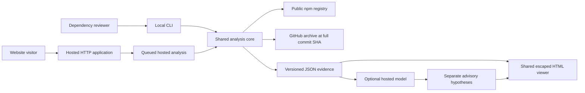
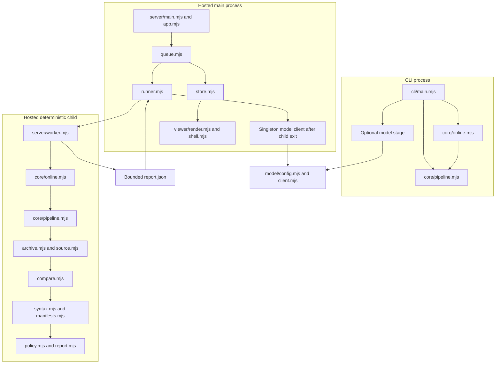
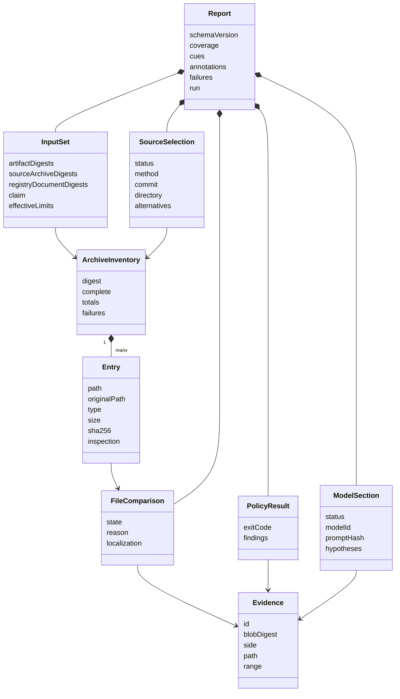
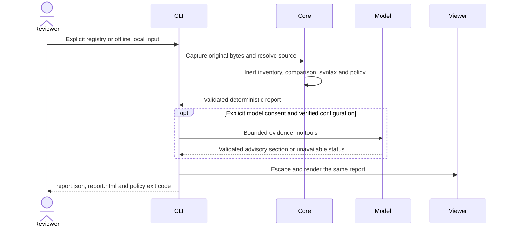
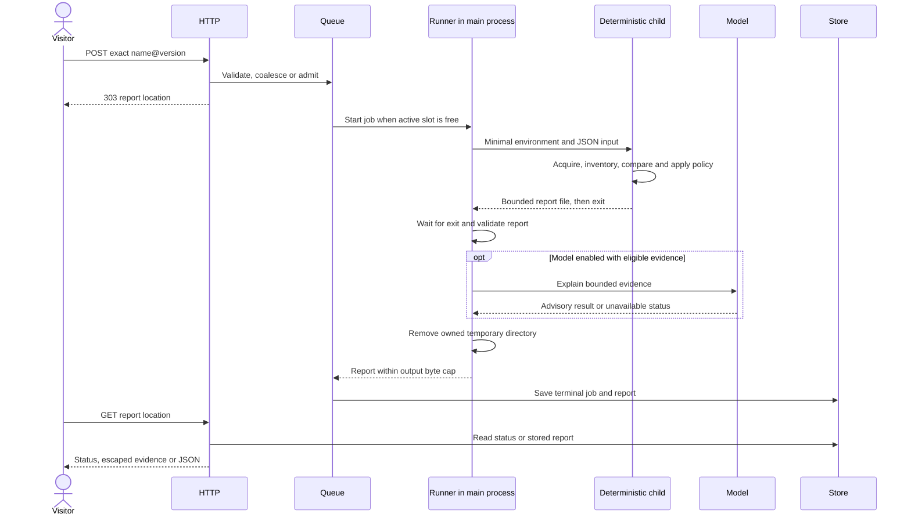
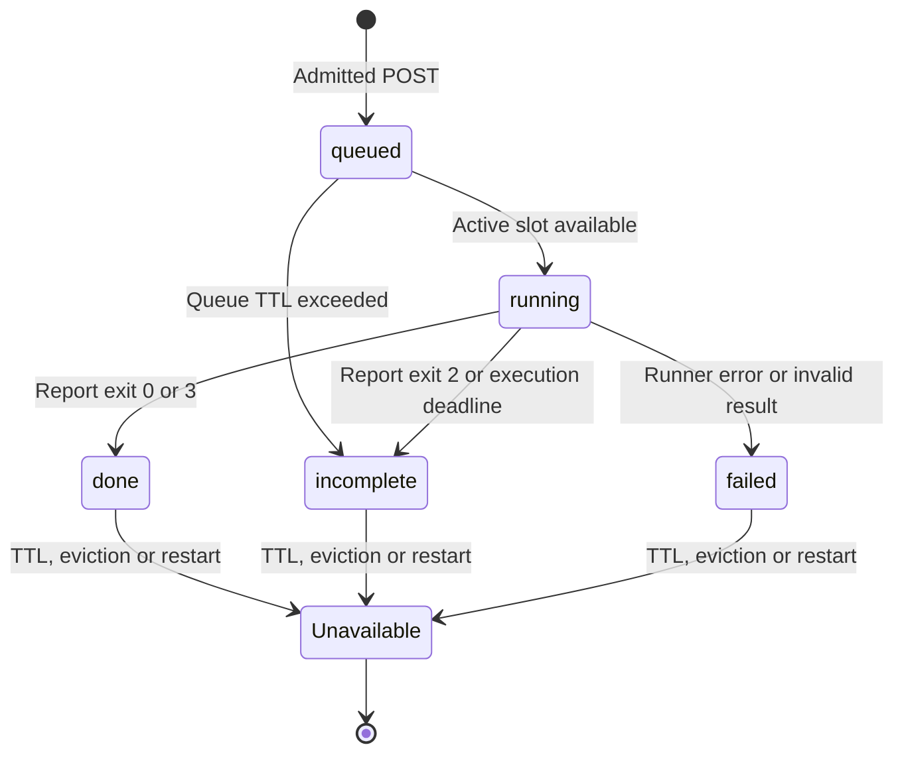

# Architecture

This is the design and pending implementation described in the
[documentation status](README.md). It is not a description of a deployed service.
The [contracts](contracts.md) define observable behavior; the
[stack](stack.md) records implementation choices and limits.

## Purpose and trust boundaries

UNMASK inventories a package tarball, selects a disclosed source reference,
compares regular-file bytes, and renders evidence for human review. An integrity
match, a source claim, byte correspondence, syntax cues and model hypotheses are
separate facts. None establishes that the whole package is safe.

Registry acquisition uses fixed approved HTTPS hosts and refuses redirects.
Offline CLI analysis reads only operator-selected local inputs. Archive contents,
filenames, manifests, source assertions and model output are untrusted data.
Target code, configuration, install hooks and build scripts are never executed.
Archive links are inventoried without following their targets. Process isolation
and resource limits reduce failure impact; they are not a security sandbox.

## User flows

A CLI user chooses either an exact registry release or a local tarball. The
current local mode requires `--offline`; an optional local source archive needs a
full commit claim and explicit archive root. The CLI writes JSON and HTML to an
explicit output directory and returns the deterministic policy exit code. It runs
the pipeline **inside the CLI process**, without the hosted queue or child runner.

A website visitor submits an exact `name@version`. POST admission returns a
private report location, and subsequent GETs read its status or result. The
website accepts neither tarball uploads nor arbitrary source URLs. Reports are
in-memory, temporary and accessible to anyone holding their random URL; there is
no account or durable report service.

Model use is optional. The CLI additionally requires `--allow-model`, including
for registry input. Hosted configuration must explicitly enable the provider and
supply verified quota limits. Missing configuration leaves deterministic analysis
available. No eligible evidence means no provider request.

## Components and process boundaries

`core/acquire.mjs` fetches bounded registry metadata and archives;
`core/resolve.mjs` interprets source claims. Registry orchestration calls the same
local pipeline after capturing input bytes. The CLI preserves digest-addressed
input copies in its explicit cache directory. Hosted jobs disable that duplicate
cache and keep captured inputs in their private per-job directory.

The hosted runner creates a trusted Node child with a 512 MiB V8 old-space limit,
minimal environment and deterministic deadline. The child writes a report
exclusively. After child exit, the parent bounds and validates it, then optionally
calls its long-lived model client. Provider credentials stay in the main process;
they are not inherited by the deterministic child.

Job directories have random names and kernel-held ownership leases inherited by
the worker. Startup preserves live jobs, including a worker whose parent has
crashed, and can remove abandoned leased jobs after worker exit. Unmarked legacy
directories are preserved when ownership cannot be established. Normal cleanup
runs after child exit on success, failure, cancellation and timeout.

## Data objects

The diagram shows relationships between **plain objects**, not runtime classes or
an inheritance framework. Functions validate and transform these records.

Input hashes bind original compressed bytes. Evidence IDs bind a side, blob,
path and half-open byte range. Public report JSON contains text evidence and
metadata, not raw Buffer objects. Coverage distinguishes inventoried bytes,
source correspondence, syntax inspection and model review.

## CLI sequence

Offline here means acquisition is disabled. Adding `--allow-model` deliberately
permits the separately configured model stage to transmit selected local excerpts;
without that consent the CLI does not construct or call a provider client.

## Hosted sequence and state

An incomplete job can retain deterministic findings. A generic failed job need
not have a report. Model failure cannot clear policy findings; a model section
that cannot fit the result cap is compacted or rejected within that same cap.
GET requests never start work or retry a model request. Shutdown aborts active
work, waits for child termination and cleanup, and closes the HTTP listener.

## Boundaries of the design

Source bytes at a claimed SHA do not prove that a publisher built the package
from those bytes. No rebuild or semantic-equivalence claim is made. Provenance
fields are not cryptographically verified by the reviewed acquisition path.
Syntax inspection supports bounded JavaScript, not general TS/JSX or all generated
code. Model quotations validate locations, not reasoning quality.

The current scope is npm only, without PyPI support, release monitoring or a
watch service. There is no durable shared queue, distributed report store or
multi-instance routing guarantee. No deployed image, successful hosted generation,
production load result or user validation is established by these diagrams.
The latest minimal provider diagnostic reached metadata and token counting, but
generation is blocked by the configured project's unavailable free tier. See the
[model status](../HACKATHON.md) for the acceptance boundary.
