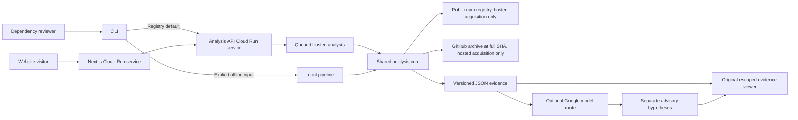
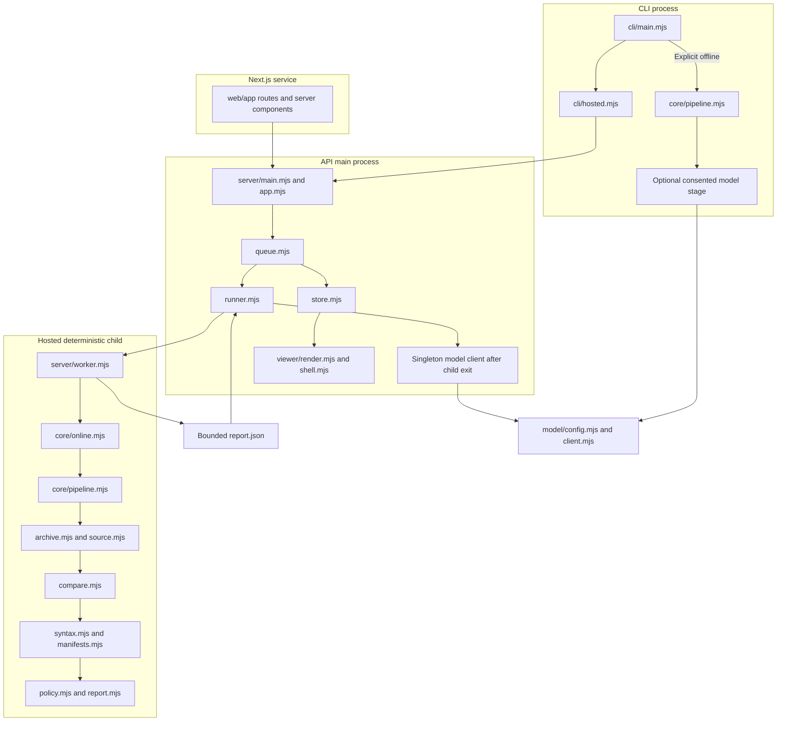
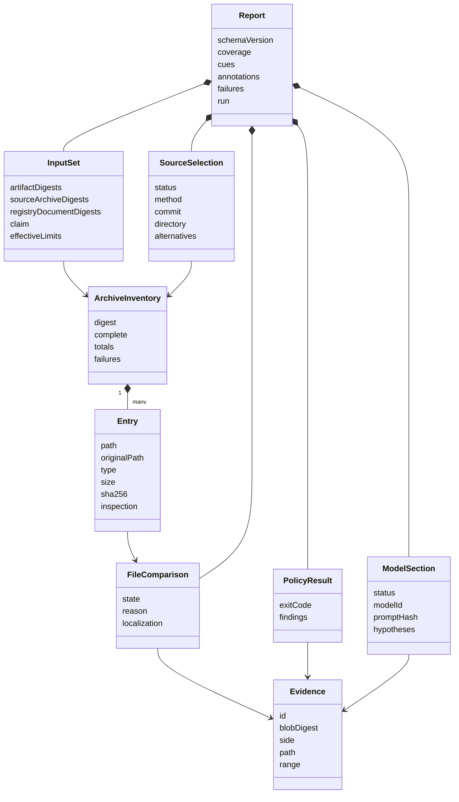
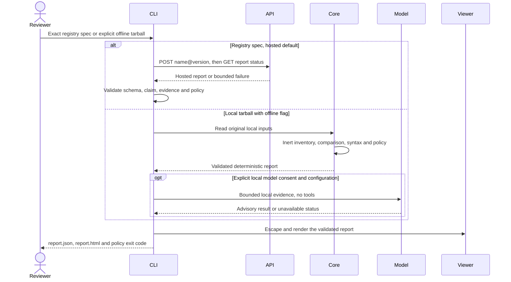
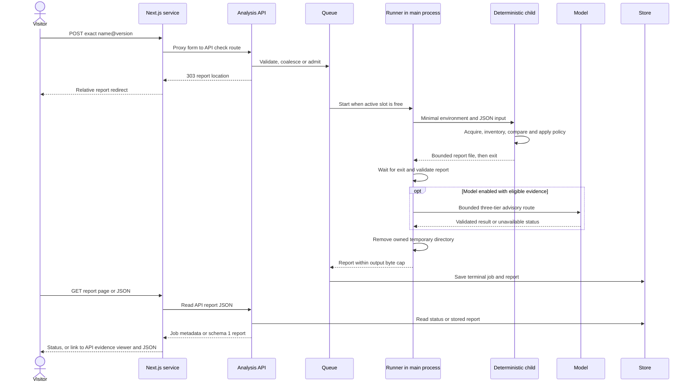
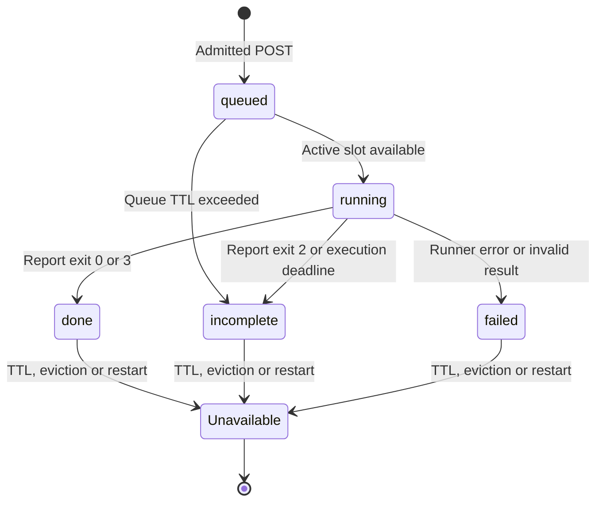

# Architecture

This page describes the implemented process boundaries and the two-service deployment recorded in the [documentation status](README.md). The [contracts](contracts.md) define observable behavior; the [stack](stack.md) records model tiers, implementation choices and limits. A live snapshot does not establish every acceptance gate.

## Purpose and trust boundaries

UNMASK inventories a package tarball, selects a disclosed source reference,
compares regular-file bytes, and renders evidence for human review. An integrity
match, a source claim, byte correspondence, syntax cues and model hypotheses are
separate facts. None establishes that the whole package is safe.
The intended dependency-review persona is a hypothesis; it has not been validated
with users.

Registry acquisition uses fixed approved HTTPS hosts and refuses redirects.
Offline CLI analysis reads only operator-selected local inputs. Archive contents,
filenames, manifests, source assertions and model output are untrusted data.
Target code, configuration, install hooks and build scripts are never executed.
Archive links are inventoried without following their targets. Process isolation
and resource limits reduce failure impact; they are not a security sandbox.

## User flows

An exact registry CLI check uses the hosted API by default: submit the name/version, poll its random report location, validate the returned report and deterministic policy, then write escaped HTML and JSON locally. The caller needs no local provider key. The client does not silently switch to local acquisition when the service fails.

A local tarball check requires `--offline`; an optional local source archive needs a full commit claim and explicit archive root. This path runs the shared pipeline inside the CLI process, without the hosted queue or worker. Optional model transmission requires separate `--allow-model` consent and local provider configuration. Offline disables acquisition, while that consent deliberately enables the advisory network stage.

A website visitor submits an exact `name@version` to the separate Next.js service, which proxies the API. The API returns a private report location, and subsequent GETs read status or results. The current Next frontend links schema 1 reports to the API's original viewer rather than treating its demonstration report shape as the live schema. Neither website nor API accepts tarball uploads or arbitrary source URLs.

The API's in-memory results last up to 30 minutes after completion, subject to capacity eviction or restart; reads do not extend the lifetime. Anyone holding a report's random URL can read it. There is no account or durable report service. Browser and hosted CLI submissions can lead the API to send bounded public package/source excerpts to Google; model availability is not guaranteed.

Model use is optional and cannot change deterministic findings. Hosted configuration explicitly enables provider access and enforces local admission controls while reporting upstream quota as unknown. Missing configuration or eligible evidence leaves an explicit disabled/skipped/unavailable state. Hosted CLI users do not supply `--allow-model`; that flag belongs to offline local evidence.

## Components and process boundaries

`core/acquire.mjs` fetches bounded registry metadata and archives;
`core/resolve.mjs` interprets source claims. Hosted registry orchestration calls the same local pipeline after capturing input bytes. Explicit offline CLI analysis can preserve digest-addressed copies in its cache directory. Hosted CLI checks do not use that local cache. API jobs disable duplicate blob persistence and keep captured inputs only in the private per-job directory.

The hosted runner creates a trusted Node child with a 512 MiB V8 old-space limit,
minimal environment and deterministic deadline. The child writes a report
exclusively. After child exit, the parent bounds and validates it, then optionally
calls its long-lived model client. Provider credentials stay in the main process;
they are not inherited by the deterministic child.

Job directories have random names and kernel-held ownership leases inherited by
the worker. Startup preserves live jobs, including a worker whose parent has
crashed, and can remove abandoned leased jobs after worker exit. Unmarked legacy
directories are preserved when ownership cannot be established. Normal cleanup
runs after child exit on success, failure, cancellation and timeout.

## Data objects

The diagram shows relationships between **plain objects**, not runtime classes or
an inheritance framework. Functions validate and transform these records.

Input hashes bind original compressed bytes. Evidence IDs bind a side, blob,
path and half-open byte range. Public report JSON contains text evidence and
metadata, not raw Buffer objects. Coverage distinguishes inventoried bytes,
source correspondence, syntax inspection and model review.

## CLI sequence

Offline here means acquisition is disabled. Adding `--allow-model` deliberately
permits the separately configured model stage to transmit selected local excerpts;
without that consent the CLI does not construct or call a provider client.

## Hosted sequence and state

An incomplete job can retain deterministic findings. A generic failed job need
not have a report. Model failure cannot clear policy findings; a model section
that cannot fit the result cap is compacted or rejected within that same cap.
GET requests never start work or retry a model request. Shutdown aborts active
work, waits for child termination and cleanup, and closes the HTTP listener.

## Boundaries of the design

Source bytes at a claimed SHA do not prove that a publisher built the package
from those bytes. No rebuild or semantic-equivalence claim is made. Provenance
fields are not cryptographically verified by the reviewed acquisition path.
Syntax inspection supports bounded JavaScript, not general TS/JSX or all generated
code. Model quotations validate locations, not reasoning quality.

The current scope is npm only, without PyPI support, release monitoring or a watch service. There is no durable shared queue, distributed report store or multi-instance routing guarantee. The [live snapshot](README.md) records two responding Cloud Run services and a completed Gemini-backed zod result. Diagrams do not establish serving image digests, production load capacity, usefulness or user validation. Prompt development on that same public package is not an independent study. Gemini is not open-weight, and the configured Gemma fallback has not established hackathon compliance; see the [model disclosure](../HACKATHON.md).
