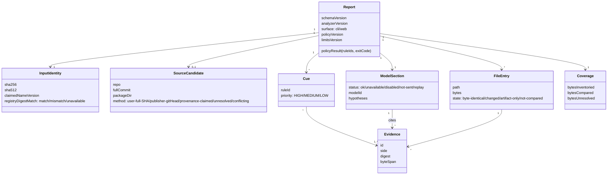

# UNMASK product requirements (PRD)

> **Working record, 31 Oct – 1 Nov 2026.** Kept as written during the hackathon, except that private identifiers were removed for publication. Statuses describe the moment of writing; the [product docs index](README.md#then-and-now) shows what shipped since.

Owner: UNMASK PM. Version 1.0, 31 Oct 2026.

Engineering source of truth: `../engineering-proposal-v26.md` (SHA-256 `758b725c…3e781d`), which is under review. Earlier versions are kept unchanged. Where this PRD and v9 disagree, v9 wins on engineering detail and this PRD wins on product intent; report any mismatch to PM/EM.

**Status tags**

- **[V]** verified, with the evidence linked
- **[P]** proposed, not yet implemented
- **[B]** blocked on a user decision or credential
- **[H]** hypothesis

Nothing in the product is implemented yet. Every feature below is [P] unless tagged otherwise. As relayed by EM, the user has authorized full product coding after these docs, as **local worktree commits only. No new PRs, pushes or deployment.**

## 1. Problem

A developer about to accept a dependency update has no tool that answers one question: **"What is in this published package that is not in the source code it claims to come from, and why?"**

- **Existing tools answer other questions** [V, `pm-product-recommendation.md` §1, `claude-pain-differentiation.md` §3]:
  - Vulnerability databases ask whether a version is known-bad.
  - Behaviour scanners ask whether it looks malicious.
  - npm provenance says where it was built. npm's own docs say provenance does not guarantee the package is free of malicious code.
- **Motivating incidents** [V as sources; anecdotal, not representative]: axios 1.14.1, nx, Shai-Hulud and xz all put their malicious change only in the published artifact.
- **Honest limit** [V, Datadog]: keyv@6.0.0 shipped malicious code that matched its source. Comparing package to source cannot catch that case.
- **The noise problem is real** [V, `pm-product-recommendation.md` §0, independently re-checked by the EM]. axios 1.21.0 has 8 of 92 files with no source twin, but those 8 files are 72.5% of its bytes. zod against `packages/zod` has 505 of 840 files and 49.6% of bytes with no twin.

## 2. Users

| User                                  | Need                                                                 | Priority                                   |
| ------------------------------------- | -------------------------------------------------------------------- | ------------------------------------------ |
| Organizer / judge                     | Run real releases and tampered local copies; see localized evidence  | Primary for the event                      |
| Developer reviewing a dependency bump | Check a package by name on the website or in the CLI before merging  | Primary product persona [H: no interviews] |
| Operator (team member)                | Release versioned artifacts from CI; deploy an exact image by digest | Internal                                   |
| Package maintainer                    | "Was this release mine?"                                             | Later [P stretch]                          |

## 3. Scope

The current agreed scope is v27, after the PM product grill (`pm-product-grill.md`).

| Capability                                                                                                                                                                                                                                                                                                                                                                                                                                                                                                                                               | Surface                                                                                                                                              | Status                                                                                                                                                                            |
| -------------------------------------------------------------------------------------------------------------------------------------------------------------------------------------------------------------------------------------------------------------------------------------------------------------------------------------------------------------------------------------------------------------------------------------------------------------------------------------------------------------------------------------------------------- | ---------------------------------------------------------------------------------------------------------------------------------------------------- | --------------------------------------------------------------------------------------------------------------------------------------------------------------------------------- |
| Check a registry `name@version`                                                                                                                                                                                                                                                                                                                                                                                                                                                                                                                          | Website (async: POST → 303 → `/r/<id>` status page) + CLI **hosted by default** (v27: the CLI calls the same service, with no silent local fallback) | Core [P], implementation pending                                                                                                                                                  |
| Result reuse for 30 minutes after completion (v27, user-requested for cost); failed or model-unavailable results never reused                                                                                                                                                                                                                                                                                                                                                                                                                            | Website and hosted CLI                                                                                                                               | Core [P], implementation pending                                                                                                                                                  |
| Model route (**latest user decision, ~01:35**; supersedes v27's Gemma-first route): `gemini-3.5-flash`/high → `gemini-3-flash-preview`/minimal → `gemma-4-26b-a4b-it`/minimal, on a model-scoped 429 or transient error; output caps 4,096 on the Gemini tiers and 1,000 on Gemma; prompt revised twice after live zod observations, before any gate run (current promptHash `82d2862a…`, configHash `169f8b2b…`); at most 3 generations in 135 s; operator caps 3/min, 12,000 TPM, 100/day (provider quota unknown); no paid or other-provider fallback | Server and hosted CLI                                                                                                                                | [P]. Access diagnostics: 3.5 Flash/high 200, Flash-Lite and 26b/minimal 200. No quality gate result yet. Open-weight acceptance is credited only to Gemma-tier output, separately |
| Check a local `.tgz` (+ optional claim, repo, full SHA)                                                                                                                                                                                                                                                                                                                                                                                                                                                                                                  | CLI                                                                                                                                                  | **Core, mandatory** [P]                                                                                                                                                           |
| Offline replay of digest-bound inputs                                                                                                                                                                                                                                                                                                                                                                                                                                                                                                                    | CLI                                                                                                                                                  | Core [P]                                                                                                                                                                          |
| One npm distribution (`dist/`: core, CLI, server, viewer); the image installs that exact tarball                                                                                                                                                                                                                                                                                                                                                                                                                                                         | npm tarball + GHCR image                                                                                                                             | Core [P]                                                                                                                                                                          |
| Versioned JSON report + escaped HTML evidence view                                                                                                                                                                                                                                                                                                                                                                                                                                                                                                       | Both                                                                                                                                                 | Core [P]                                                                                                                                                                          |
| CLI exit codes 0/2/3 (1 = internal error)                                                                                                                                                                                                                                                                                                                                                                                                                                                                                                                | CLI                                                                                                                                                  | Core [P]                                                                                                                                                                          |
| Same policy rule IDs shown as "review required"                                                                                                                                                                                                                                                                                                                                                                                                                                                                                                          | Website                                                                                                                                              | Core [P]                                                                                                                                                                          |
| Hosted Gemma explanations in a separate panel (every CLI model request needs `--allow-model` (v23); the website uses server configuration; 4,000 input tokens per attempt; **output cap: Gemini tiers 4,096 (deliberate: high thinking consumes the output budget; a diagnostic hit MAX_TOKENS at 957 thought + 39 text tokens under 1,000), Gemma 1,000**; JSON mode on Gemini only, lower if the quota requires; temperature 0, thinkingLevel minimal; any open-weight model is allowed, but no switch has been chosen)                                | Both                                                                                                                                                 | Core [P], acceptance [B: key + budget]                                                                                                                                            |
| CI artifact release: immutable `vX.Y.Z`, tarball, GHCR image, manifest with `registryPublished`                                                                                                                                                                                                                                                                                                                                                                                                                                                          | CI                                                                                                                                                   | Core [P]. Registry publication [B: npm account; owner bootstraps with 2FA, then OIDC]                                                                                             |
| Deploy an exact image digest via the App Platform App Spec editor (`image.digest`, no tag)                                                                                                                                                                                                                                                                                                                                                                                                                                                               | Operator                                                                                                                                             | [P] [B: DO project + deployment not authorized]                                                                                                                                   |
| Website `.tgz` upload                                                                                                                                                                                                                                                                                                                                                                                                                                                                                                                                    | —                                                                                                                                                    | **Removed** (21:30 cut trigger)                                                                                                                                                   |
| Package review summary: Incomplete if and only if exit 2 (findings stay visible under it); otherwise Review required / Review suggested / none found; "Completed, source unavailable" shows 0% source coverage; counts and coverage, no grade                                                                                                                                                                                                                                                                                                            | Both                                                                                                                                                 | Core [P]                                                                                                                                                                          |
| Literal and capability novelty cue (AST, JS only; a direct literal as the first argument of a recognized call; no alias tracking; not-assessed when there is no source JS or the index is truncated; never exit 3)                                                                                                                                                                                                                                                                                                                                       | Both                                                                                                                                                 | Core [P], distribution measured first                                                                                                                                             |
| Model job (v18 scope: **every changed or artifact-only hunk, including manifest**; unpaired hunks may still be review-concern; possible-transformation needs supplied paired citations; scored against a pre-registered B1 baseline; human grading unmet): triage category using the implemented IDs (`review-concern` / `possible-transformation` / `unknown`) with a cited rationale, over deterministic context; end-to-end recall where omissions count as misses, plus conditional accuracy; novelty is never credited to the model                 | Both                                                                                                                                                 | Core [P], acceptance [B: key]                                                                                                                                                     |
| PyPI adapter, release monitoring                                                                                                                                                                                                                                                                                                                                                                                                                                                                                                                         | —                                                                                                                                                    | **Unmet named objectives**, disclosed. The user decides whether to accept                                                                                                         |
| PyPI, watch feed, PR-bump action, transform stage, Sigstore verification, local Ollama                                                                                                                                                                                                                                                                                                                                                                                                                                                                   | —                                                                                                                                                    | Stretch [P]                                                                                                                                                                       |

## 4. Non-goals

These are out for the hackathon:

- declaring any package "safe"
- detecting malicious source that matches its artifact
- installing, building or running any target code
- arbitrary URL input
- accounts or an auth platform
- any website upload
- private repositories
- a custom deploy portal or operations page
- per-package allowlists
- automatic comments on real projects
- population detection-rate or FPR claims

## 4a. Positioning and honesty

- **What is different:** a file-by-file comparison of the published tarball against the claimed source commit, with evidence. It works on local copies and does not depend on a rebuild service's coverage.
- **What is not novel:** registry-manifest versus tarball mismatch. Socket ships this as "manifest confusion" ([source](https://socket.dev/blog/manifest-confusion)).
- **Persona:** a hypothesis with no interviews. The judged use case is tamper analysis of local copies. This is stated prominently.

## 5. Product principles

1. **Evidence, not verdicts.** Every page says it shows evidence for review. The strongest positive claim is "these bytes correspond to this source".
2. **Nothing disappears.** Unknown, over-cap, link and prefixless bytes stay visible. Coverage leads with bytes, not files.
3. **The model explains and never decides.** Model output cannot change states, cues or exit codes. Quotes are checked mechanically. A valid citation proves the location, not the reasoning.
4. **One engine.** The same input gives the same deterministic report on the website and in the CLI.
5. **Honest about state.** Model-off, quota, replay, not-assessed and blocked are always labelled.

## 6. Success criteria for the event

All of these are [P], and none is met yet.

- Every injected location in the 8 variants and 2 held-out variants is visible as changed, artifact-only or not-compared.
- The policy tests hit the exact expected rule IDs.
- CLI and website deterministic reports are byte-identical on the four registry references for the full parity key (artifact, source and registry-doc digests, policy version, analyzer version and `limitsVersion` with actual configured limits), including a fixture that crosses the 128 MiB retention cap and an opposite-fetch-order test. All time, cache, host and surface fields sit in the excluded `report.run`, tested through the recorded fetcher.
- The hosted model gate passes on 5 fixtures (5/5 valid, at least 4/5 useful, no unsupported claims, each attempt at or under 45 s). This needs a key and a budget.
- Artifact release `v0.1.0` has a manifest binding commit, tarball hashes and image digest (`registryPublished: false` until npm exists). The deployed digest equals the manifest digest only if deployment is authorized.
- A 3-minute demo with no fabricated state.

## 7. Conceptual domain model

This is product vocabulary. Engineering owns the exact schema in v27 and `../engineering/CONTRACTS.internal.md`, and `schema/report.schema.json`.

## 8. Open user decisions

None of these blocks the first CLI slice. Decision 1 blocks the first artifact release; its target is 03:00 IST. 0. **Both 1 and the 05:30 push/PR authorization are required for any artifact release. The user's absence is never permission.**

1. ✅ **ANSWERED (~23:20, `decisions-log.md`):** the account exists, the owner is `xagents_in` and the package is `@xagents_in/unmask`. Local config only; it stays private at 0.0.0 with nothing published. The original requirement read: **By 03:00 IST, before the first artifact release:** the scoped package name string and the intended owner identity (npm user or org). Account creation is not required for this step. Without an answer, there is no artifact release or deployment; the demo uses the exact local candidate, labelled unreleased, and release acceptance is unmet. Registry publication still waits for the actual account owning the scope. Until then the working package is private `unmask@0.0.0`, with no ownership claim. The public unscoped `unmask` was unpublished in 2019 and its reuse is unknown. The owner then bootstraps the exact tarball with 2FA, followed by OIDC trusted publishing.
2. DigitalOcean project, budget, region, domain, and deployment authorization.
3. Gemini API key and project budget/quota, and acceptance of the free-tier data terms.
4. GHCR visibility (public recommended).

## 9. Related documents

- Evidence and research: `pm-evidence-notes.md`, `claude-pain-differentiation.md`, `codex-ecosystem-partial.md`
- Recommendation with corrected counts: `pm-product-recommendation.md`
- Hosted-scope decisions: `pm-scope-addendum-hosted.md`
- Journeys and diagrams: `user-journeys.md`
- Stories and acceptance: `user-stories.md`
- Demo and evaluation: `demo-eval-plan.md`
- Delivery and handoff: `delivery-handoff.md`
