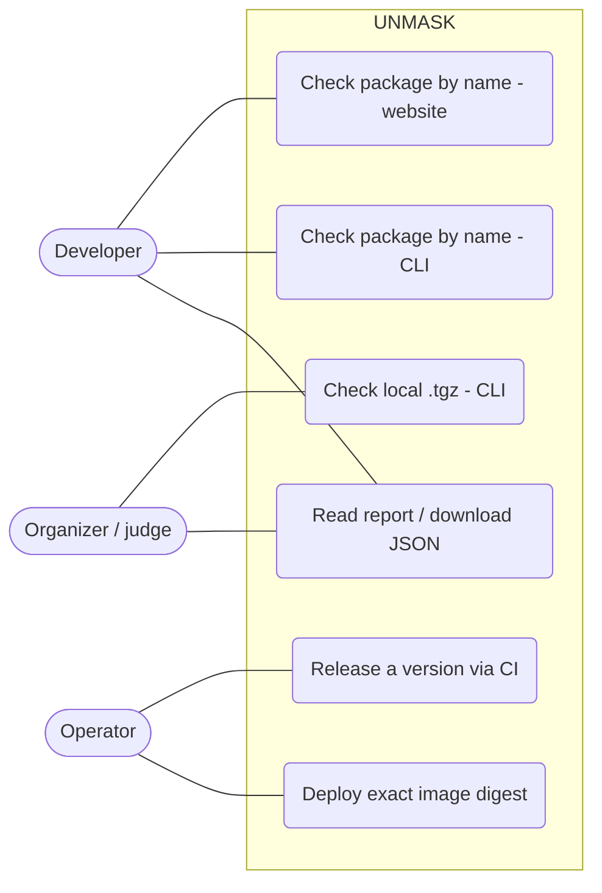
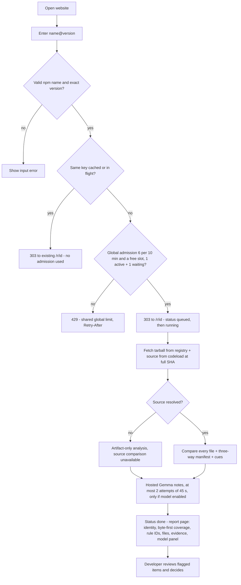
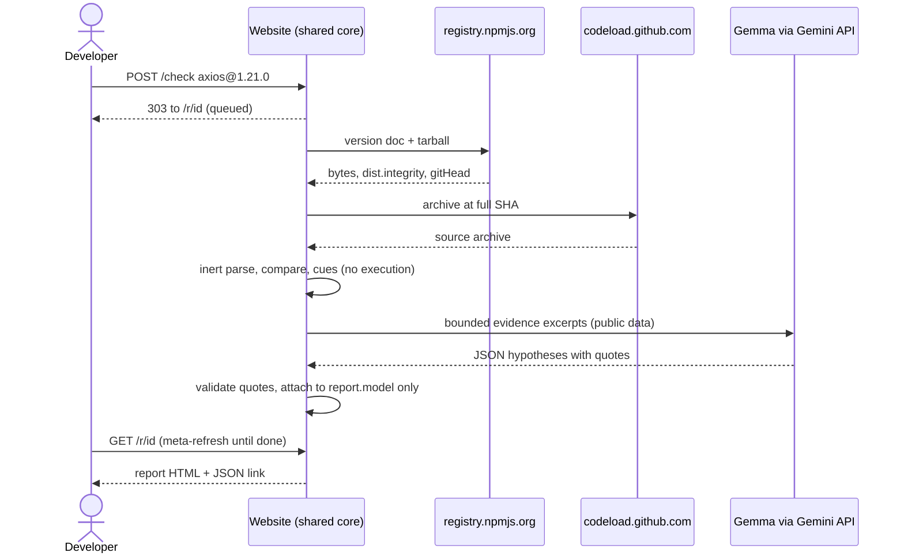
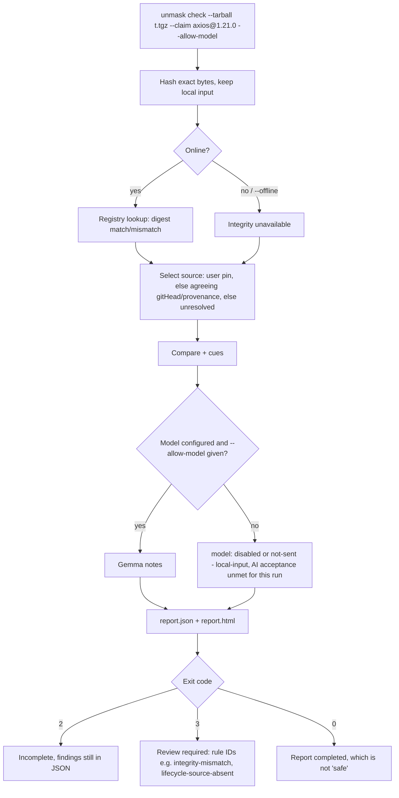
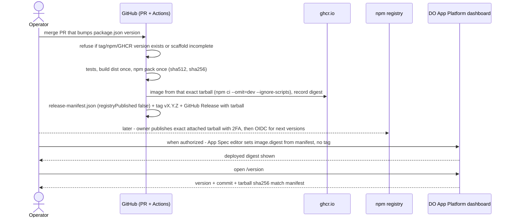

# UNMASK user journeys and diagrams

> **Working record, 31 Oct – 1 Nov 2026.** Kept as written during the hackathon, except that private identifiers were removed for publication. Statuses describe the moment of writing; the [product docs index](README.md#then-and-now) shows what shipped since.

All flows are **proposed [P]**; nothing here was implemented when they were drawn.

## Use cases

## Journey 1: developer checks an update on the website (core)

## Journey 2: judge checks a tampered local copy with the CLI (core, mandatory)

## Journey 3: website upload

Removed from scope in v10 (21:30 cut trigger). Local tarballs are checked with the CLI only (Journey 2).

## Journey 4: operator releases and deploys (artifact release core; npm and deploy blocked)

