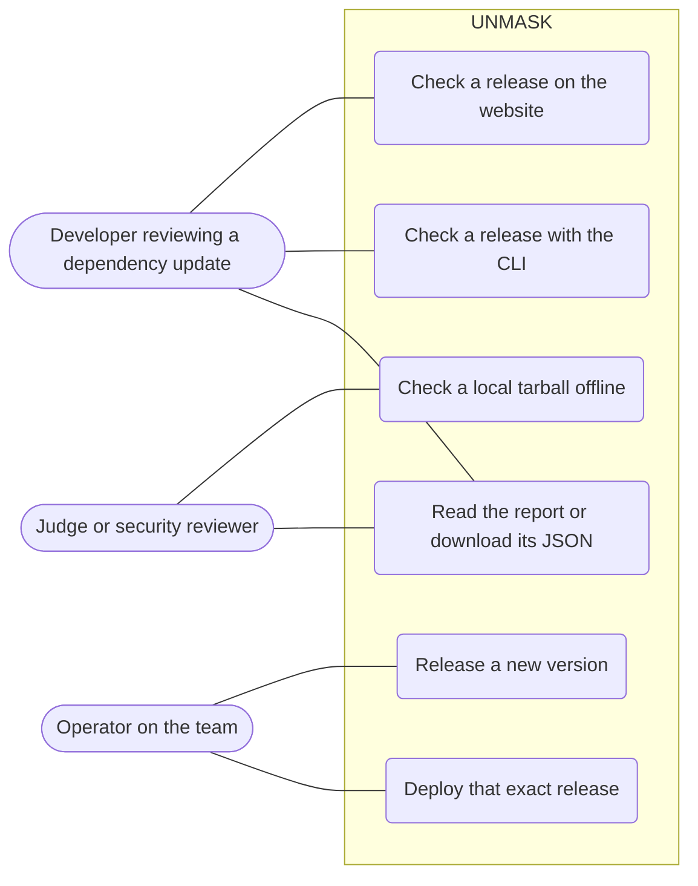
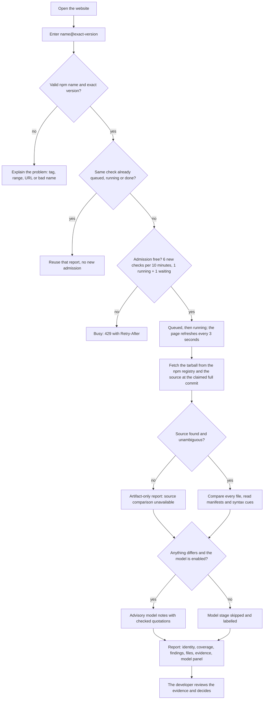
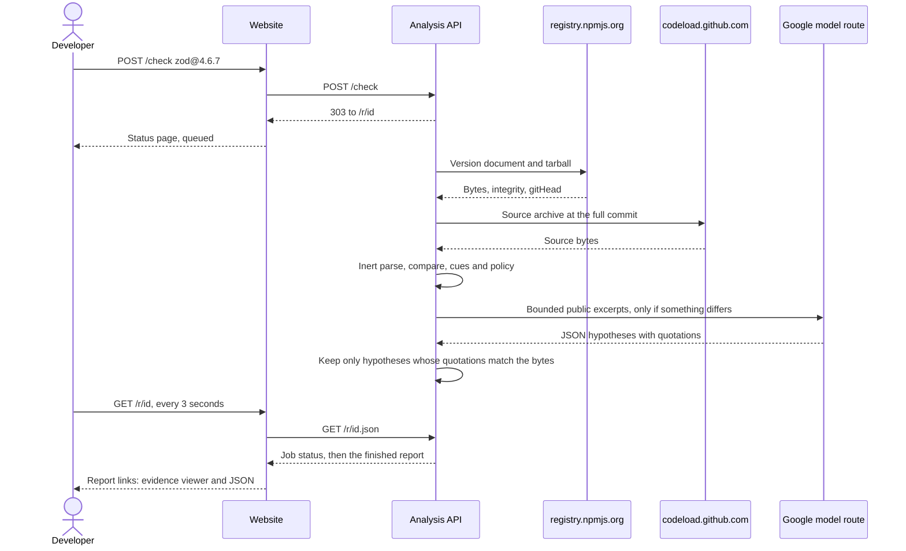
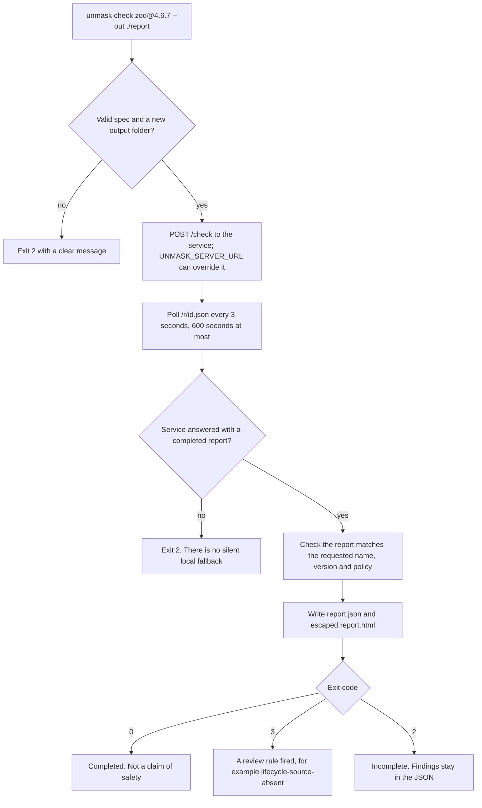
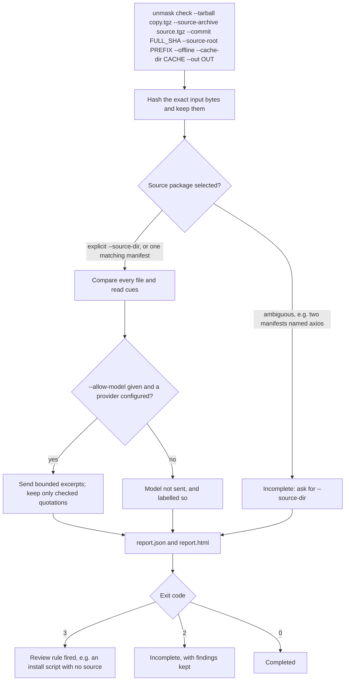
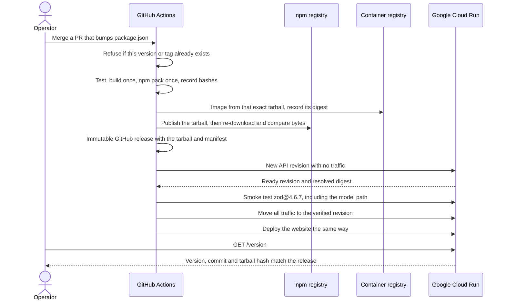
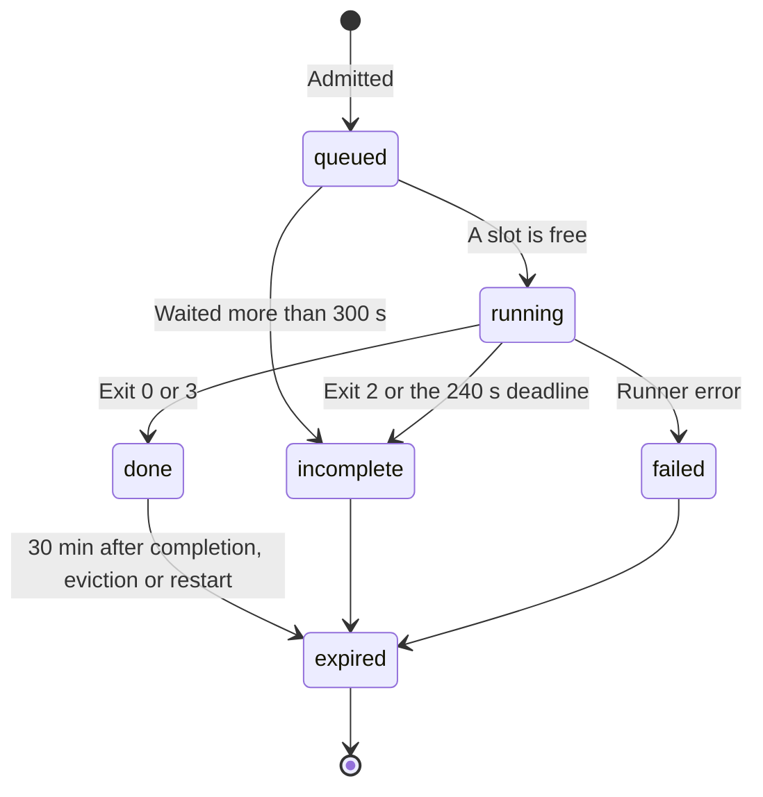

# User journeys

How people use UNMASK, from a first check to a production release. Each journey
has a diagram and the facts that matter to the person taking it. Behavior is
described as it works on 1 November 2026; [user stories](user-stories.md) give
the acceptance criteria and status of each step.

## Who uses UNMASK

| Person    | What they want to know                                                    | Where they start              |
| --------- | ------------------------------------------------------------------------- | ----------------------------- |
| Developer | "What is in this published package that is not in its source, and where?" | Website or `unmask check`     |
| Reviewer  | "Is the planted change in this tampered copy found and localized?"        | `unmask check --offline`      |
| Operator  | "Is the deployed service exactly the released, tested build?"             | A version bump merged to main |

No journey ends in a verdict of "safe". Every journey ends with evidence that a
person reviews.

## 1. Check a release on the website

A developer enters an exact `name@version`. The website hands the check to the
analysis API, which fetches both sides, compares them without running anything,
and stores a temporary report.

What the developer should know:

- Only the package name and version are submitted. No upload exists.
- Nothing from the package is installed, built or run.
- A finished report is reused for up to **30 minutes**. It can disappear sooner
  after a restart, so download the JSON to keep it.
- The website shows queued, running, incomplete and failed states. A finished
  check opens in the analyzer's evidence viewer; the website's own viewer shows
  the clearly labelled sample report.

## 2. Check a release with the CLI

The CLI sends the same exact spec to the hosted service, so a developer gets the
same report without any local model key.

- Sent: the package spec only. Not sent: local files, environment values or keys.
- Existing report files are never overwritten.
- `--allow-model` is rejected in hosted mode, because the service owns the model
  policy.

## 3. Check a local tarball offline

A reviewer checks a copy that may have been tampered with. Nothing is fetched;
every input is a local file chosen by the reviewer.

- `--offline` makes no network request. Registry integrity shows as unavailable.
- The same inputs always give the same deterministic report.
- Excerpts leave the machine only with `--allow-model`.

## 4. Release and deploy

An operator bumps the version and merges. CI turns that one commit into one
tarball, one image and one running service, and checks they match.

- A failed smoke test after promotion rolls traffic back to the previous verified
  revision when it is safe to do so.
- `/version` is the liveness check, because Cloud Run reserves some paths that end
  in `z`, such as `/healthz`.

## 5. What happens to a check over time

A page view never starts or retries a check. Failed and model-unavailable results
are not reused; submitting again starts a new check.

## Removed from scope

**Website upload.** Uploading a tarball to the website was cut on 31 October to
keep the hosted service free of user files. Local copies are checked with the CLI
(journey 3).
